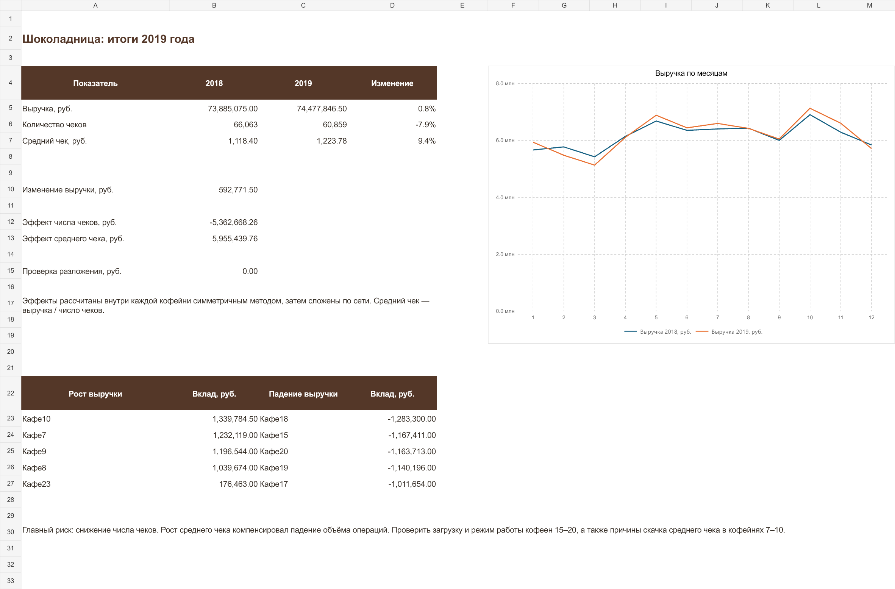

# Шоколадница — тестовое задание аналитика

Решение трёх блоков: Excel, SQL и анализ выручки 27 кофеен за 2018–2019 годы.

## Готовые файлы

- [Excel: три задания с формулами](Шоколадница_Excel.xlsx)
- [Анализ выручки, вклад объектов и факторов](Шоколадница_Анализ.xlsx)
- [SQL: решения в исходной книге заданий](Шоколадница_SQL.xlsx)
- [Подробный конспект с объяснениями и подготовкой к защите](Конспект.md)
- [Конспект в формате Word, 6 страниц](Конспект.docx)
- [SQL: руководители и зарплаты](01_managers.sql)
- [SQL: первый заказ клиента](02_first_order.sql)

## Основные результаты

| Показатель | 2018 | 2019 | Изменение |
|---|---:|---:|---:|
| Выручка, руб. | 73 885 075,00 | 74 477 846,50 | +0,80% |
| Число чеков | 66 063 | 60 859 | −7,88% |
| Средний чек, руб. | 1 118,40 | 1 223,78 | +9,42% |

Выручка выросла на **592 771,50 руб.** Рост среднего чека компенсировал снижение числа операций. При симметричном разложении внутри кофеен эффект числа чеков составляет −5 362 668,26 руб., эффект среднего чека +5 955 439,76 руб.

Наибольший положительный вклад дали Кафе10 (+1,340 млн руб.), Кафе7 (+1,232 млн), Кафе9 (+1,197 млн) и Кафе8 (+1,040 млн). Наибольший отрицательный вклад — Кафе18 (−1,283 млн), Кафе15 (−1,167 млн) и Кафе20 (−1,164 млн).

В Excel-заданиях сумма порций за понедельник–среду — **5 994**, общий итог без повторного счёта промежуточных сумм — **12 578**.

## Метод и проверки

Исходный набор содержит 648 строк: 27 кофеен × 24 месяца. Проверены полнота периодов, отсутствие пустых ключевых полей и дубликатов объекта–года–месяца. Средний чек рассчитан как отношение сумм. Факторное разложение по объектам сходится с общим изменением выручки.

SQL использует `EXISTS`, соединение таблицы с самой собой, CTE и `ROW_NUMBER`. В неполном примере руководитель 3 отсутствует в реестре: основные расчёты используют руководителей, присутствующих в `db`, и отдельно находят отсутствующие ссылки. При равных датах первым считается заказ с меньшим `OrderID`.

Формулы дополнительно проверены в Microsoft Excel: пересчёт, добавление строки таблицы, нормализация ФИО и сверка изменения выручки. SQL прошёл проверки в SQLite. Конспект проверен после рендеринга в Microsoft Word.

## Исходники и повторение расчётов

[Скачать полный проект](Шоколадница_полное_решение.zip): исходные задания, код, готовые книги, конспект и результаты проверок. Распакуйте архив: команды ниже выполняются из его корневой папки.

## Повторить расчёты

```bash
python -m pip install -r requirements.txt
python src/analyze.py
python src/verify.py
```

Для пересборки книг нужен Node.js с `@oai/artifact-tool` из среды Codex: `node src/build_workbooks.mjs`. Готовым книгам эта среда не нужна. Анализ Python сохраняет CSV и контрольные значения, но не пересобирает Excel автоматически.

В `data/` сохранены три чистых исходных задания. В `docs/` — конспект. В `outputs/` — готовые книги и CSV. В `qa/` — контрольные результаты. Прежние заполненные варианты не использовались как исходные данные.

Выводы относятся к историческому учебному набору. Данные не позволяют отделить изменение цен от состава корзины или установить число уникальных гостей и прибыль.


## Предпросмотр


